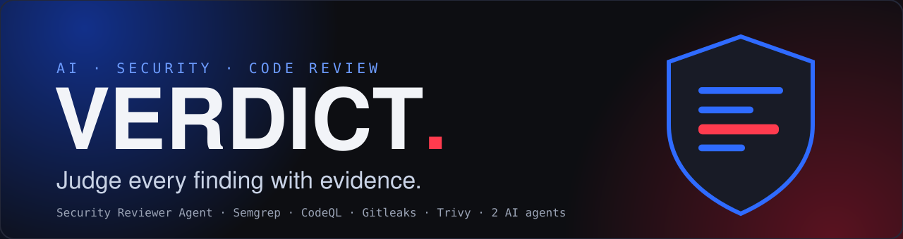
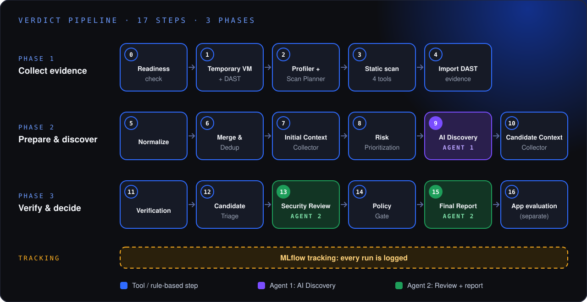

  

  
  
  
  

  <a href="#-overview">Overview</a> ·
  <a href="#-the-problem">Problem</a> ·
  <a href="#-whats-different">What's different</a> ·
  <a href="#-pipeline">Pipeline</a> ·
  <a href="#-coverage-map">Coverage</a> ·
  <a href="#-evaluation-plan">Evaluation</a>

---

## 🛡️ Overview

**Verdict** is a pre-deployment security review pipeline. It runs proven scanners and runtime checks, then puts **two AI agents** on top to find what the scanners missed and to judge what they found.

| | Role | In one line |
|---|---|---|
| 🔎 **Scanners** | Semgrep · CodeQL · Gitleaks · Trivy + runtime (DAST) probes | Produce raw findings and runtime evidence |
| 🟣 **Agent 1: AI Discovery** | Step 9 | Hunts coverage gaps the scanners did not flag. Every candidate must pass independent verification. |
| 🟢 **Agent 2: Security Review** | Steps 13 and 15 | Reviews scanner findings and verified candidates, gives each a verdict, writes the final report |
| 📈 **MLflow** | Tracking | Logs every run so results are reproducible and comparable |

**Team:** Hossam Elnagar · Safaa Abu Alsoud, internship / academic security research project.

## 🔴 The problem

Static scanners (SAST) detect suspicious code patterns, but they have three chronic weaknesses:

- **False-positive floods.** Engineers get buried in alerts and start ignoring the tool.
- **No context.** A scanner cannot tell if the input was sanitized, if the path is reachable from outside, or if the flaw only exists at runtime (for example broken access control).
- **Narrow scope.** Real risk also lives in dependencies, Dockerfiles, CI/CD configuration, and the running application.

> ### The research question
> **Does an AI agent on top of existing scanners add *measurable* value, or does it just repeat the scanner's output in nicer language?**
> Verdict is built to prove or disprove this, not to assume it.

## ✨ What's different

"Scanner + LLM" is not new: **IRIS**, **LLM4SA**, **Vul-RAG** and **LATTE** in research, and Semgrep Assistant, Snyk DeepCode AI and GitHub Copilot Autofix in industry. Verdict targets what is still missing:

| | |
|---|---|
| 🌐 **One scope** | Code, dependencies, secrets, Dockerfiles/CI and the running app in a single pipeline |
| 🧪 **Real runtime proof** | Verification against a running test app, not static reasoning alone |
| 🔒 **Evidence-gated AI** | AI-discovered candidates are held to a stricter, independent check before they are trusted |
| 📊 **Transparent benchmark** | Scanner-only vs LLM-only vs Hybrid, same code, same ground truth |

<b>Scanner only vs Scanner + Agents</b>

| | Scanner only | Scanner + Agents (Verdict) |
|---|---|---|
| Detects | Pattern matches | Patterns, cross-function issues, discovered gaps |
| Context | None | Surrounding code, data flow, runtime responses |
| Runtime issues (IDOR, headers, ...) | Cannot detect | Verified by runtime / authorization tests |
| Verdict | Flags everything | Confirmed / Likely / False Positive / Needs More Evidence |
| Output | Raw, noisy list | Ranked, evidence-backed, policy-gated report |

## 🧭 Pipeline

17 steps (0 to 16) in three phases. Purple is Agent 1, green is Agent 2, blue is every tool or rule-based step.

  

<b>Step reference (what each step does)</b>

| # | Step | Type | What it does |
|---|---|---|---|
| 0 | Readiness check | Rule-based | Checks permissions, paths, results folder, CodeQL and AI provider. A failure blocks the start and says why. |
| 1 | Temporary VM + DAST first | Rule-based | Isolated worker with no network switch. Bounded HTTP and authorization probes. Evidence saved, VM powered off. |
| 2 | Profiler + Scan Planner | Rule-based | Maps files, languages and dependencies, then plans the tools. If the source changes mid-run, the scan stops. |
| 3 | Static scan | Tools | Semgrep CE, CodeQL CLI, Gitleaks, Trivy. A tool counts only if its output is read successfully. |
| 4 | Import DAST evidence | Rule-based | Validates `runtime.json` and `authorization.json` from the VM. Original evidence is never changed. |
| 5 | Normalize | Rule-based | One Finding format for all tool and DAST output. |
| 6 | Merge & Dedup | Rule-based | Careful merging, original records kept. "40 merged observations" is not "40 confirmed vulnerabilities". |
| 7 | Initial Context Collector | Rule-based | Code around each alert and its linked evidence. |
| 8 | Risk Prioritization | Rule-based | Orders work groups by risk and evidence. Never drops findings and never proves a flaw. |
| 9 | **AI Discovery** | 🟣 **Agent 1** | Searches planned areas the scanners may have missed. Outputs candidates that need verification. Not free-form DAST. |
| 10 | Candidate Context Collector | Rule-based | Text and lines behind each AI suggestion. |
| 11 | Verification | Rule-based | Citations must match the real file and line. "Confirmed" here means the text evidence is verified in source, not that the flaw is exploitable. |
| 12 | Candidate Triage | Rule-based | Merges only clear matches; ambiguous items stay visible. |
| 13 | **Security Review** | 🟢 **Agent 2** | Reviews eligible groups in batches: Confirmed / Likely / False Positive / Needs More Evidence. |
| 14 | Policy Gate | Rule-based | Block, warn or allow. A failed gate means release blocked, not a scan error. |
| 15 | **Final Report** | 🟢 **Agent 2** | Keeps tool findings, AI suggestions, source evidence, verdicts, policy decisions and uncovered gaps clearly separated. |
| 16 | Educational-app evaluation | Separate command | Compares the report with the 15 known scenarios. Answers never reach the scanners or the AI. |

### Policy Gate

| Verdict + severity | Decision |
|---|---|
| 🔴 Critical / High, confirmed | **Block** |
| 🟠 Medium | **Warn** |
| 🔵 Low | **Record** |
| ⚪ Unconfirmed | Not treated as a confirmed risk |

### Safety rules

- Mutating and cross-account runtime tests run **only** behind explicit flags: `--runtime-mutating` and `--authorization-checks`.
- AI Discovery has request and context limits and may not run arbitrary attacks inside the VM.
- A run is only "completed" if all four tools, AI Discovery and group review succeeded.

## 🗺️ Coverage map

| Vulnerability | Detected by |
|---|---|
| SQL Injection | Semgrep + OWASP ZAP |
| XSS (Reflected / Stored) | Semgrep + OWASP ZAP |
| Command Injection | Semgrep + custom Python tests |
| Path Traversal | Semgrep + ZAP or Python tests |
| Hardcoded Secrets | Gitleaks |
| IDOR | Python tests with two test accounts |
| CORS Misconfiguration | OWASP ZAP + custom HTTP check |
| Vulnerable Dependencies | Trivy |
| Insecure Docker settings | Trivy |

CodeQL runs alongside Semgrep for source flow analysis.

## 📈 Experiment tracking

Each run is logged with **MLflow** so the three evaluation conditions can be compared reproducibly. The exact parameters, metrics and artifacts to log are still to be decided by the team.

## 🧪 Evaluation plan

> **No results yet.** This section describes the plan.

Three conditions on the same code, the same ground truth and the same metrics:

| Condition | What it isolates |
|---|---|
| **Scanner-only** | The baseline |
| **LLM-only** | No scanner, no tools: does the LLM's own reasoning help at all? |
| **Hybrid** | The full pipeline above |

**Metrics:** Precision · Recall · F1 · False Positive Rate · remediation correctness · severity / prioritization quality · latency and token cost.

**Also planned:** a held-out secondary test set (so results are not memorized from one benchmark such as OWASP Benchmark) and failure analysis by error type: false positive, false negative, wrong classification, wrong reasoning.

> **How to read 15/15.** Finding all 15 known scenarios means the known cases were found *in this educational app*. It does not prove detection of every vulnerability in any project, and it does not measure precision from a positive-only sample.
