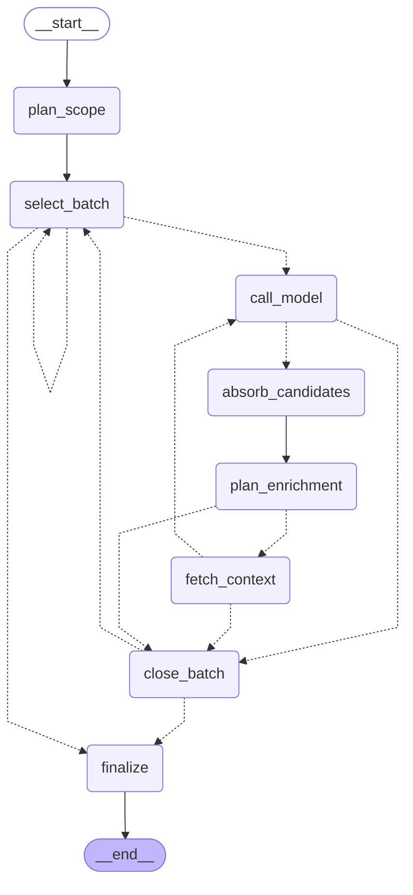
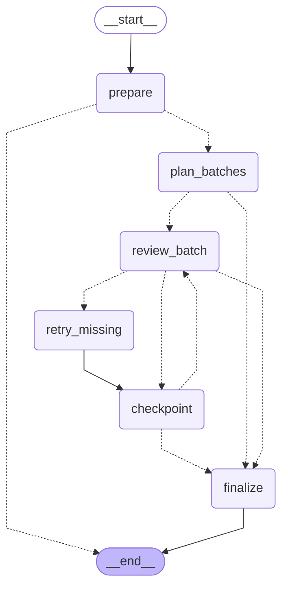

# Agents (LangGraph + LangSmith)

The two AI agents are LangGraph state machines. Every step is a named node, so a run can be
inspected, timed and compared in LangSmith. Behaviour is unchanged from the previous loops:
all existing tests pass against the graph implementation.

| Agent | Entry point (unchanged API) | Graph module |
|---|---|---|
| AI Discovery | `DiscoveryAgent(provider, config).run(...)` | `discovery/graph.py` |
| Security Review | `run_security_review(...)` | `reviewers/graph.py` |

Design rules: **state is progress, dependencies are inputs** (provider, config, evidence live in an
immutable `*Inputs` object; the graph state holds only what changes); nodes return partial updates and never
mutate state; deterministic domain logic (prompt building, candidate verification, review parsing) stays in
`agent.py` and is unit-tested separately; routing reads one field, `phase`.

## AI Discovery agent



| Node | Responsibility |
|---|---|
| `plan_scope` | Plan targets; apply explicit `target_ids`; seed coverage gaps. |
| `select_batch` | Pick the next batch and build a size-bounded prompt; skip targets that cannot fit. |
| `call_model` | One provider call (traced as an `llm` span with token usage). A provider error ends the batch. |
| `absorb_candidates` | Deterministically verify every candidate against real source before keeping it. |
| `plan_enrichment` | Decide whether requested extra context fits the per-batch budget. |
| `fetch_context` | Fetch bounded source context and re-prompt (loops back to `call_model`). |
| `close_batch` | Record the batch, fire `on_batch`, stop on a fatal provider error. |
| `finalize` | Compute gaps and an honest `completed` / `partial` / `blocked` status. |

## Security Review agent



| Node | Responsibility |
|---|---|
| `prepare` | Build per-group evidence, reuse matching saved reviews, stop early if nothing is reviewable. |
| `plan_batches` | Pack groups into batches bounded by group count and prompt size. |
| `review_batch` | Review one batch (traced `llm` span). A provider error stops the run. |
| `retry_missing` | Re-ask once, individually, for every group the model skipped. |
| `checkpoint` | Apply deployment scoping, publish a progress snapshot, advance. |
| `finalize` | Assemble the result; unreviewed groups stay in `pending` and never look safe. |

## LangSmith tracing

Off by default. Enable with the standard variables:

```bash
export LANGSMITH_TRACING=true
export LANGSMITH_API_KEY=...                       # from smith.langchain.com
export LANGSMITH_PROJECT=security-reviewer-v2      # optional, this is the default
python scripts/run_pre_review_pipeline.py ...      # one trace per pipeline run, both agents nested
```

You get one trace named `pre-review-pipeline` containing `discovery-agent` and `security-review-agent`, each
with its nodes, router decisions (`route_after_*`), model-call spans (`discovery-model-call`,
`security-review-model-call`, `security-review-retry`), latency and token usage.

### Privacy — what is uploaded

Prompts contain repository source, so uploads are scrubbed on the client before they leave the machine.
`SECURITY_REVIEWER_TRACE_CONTENT` selects the level:

| Mode | Uploaded |
|---|---|
| `metadata` *(default)* | Structure, timings, counts, statuses, token usage. Every string longer than 200 characters (prompts, code, model output) becomes `<hidden N chars sha256:…>`. |
| `redacted` | Prompts and outputs with credentials removed (`redact_source`), each string truncated to 4,000 characters. |
| `full` | As `redacted`, without truncation. Use only for non-sensitive targets. |

Credentials are removed in every mode. The scrubbing is attached to the client these agents use, so it holds even
when `LANGSMITH_TRACING` is set globally.

## Operating notes

* `recursion_limit` is derived from the configured budgets (`max_batches`, `max_enrichment_rounds`, group count), so large runs cannot hit LangGraph's default of 25 steps.
* Regenerate the diagrams after changing a graph: `python scripts/export_agent_graphs.py` (no model calls).
* Add a node: write a method returning a partial state update, register it in `compile()`, route with `_add_routes`.
